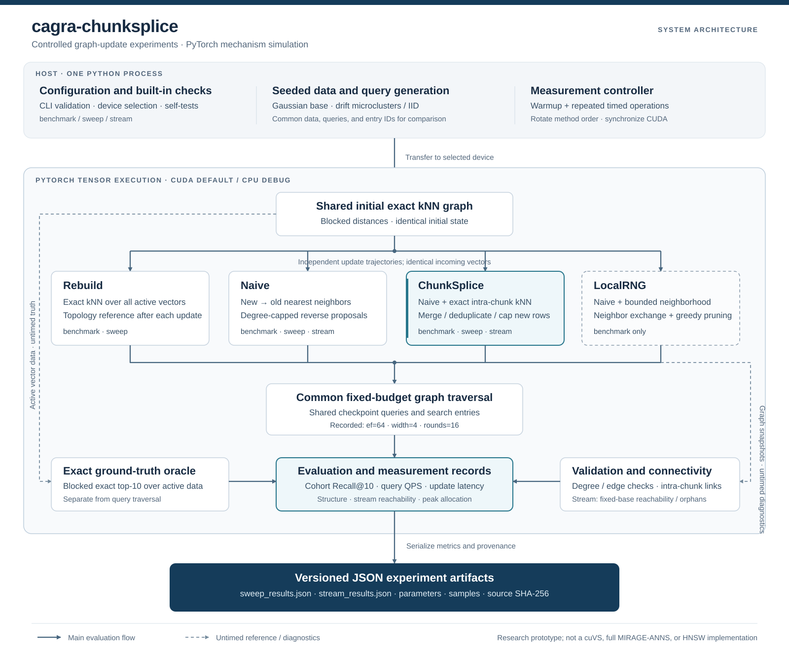

# cagra-chunksplice

**A controlled PyTorch study of intra-chunk connectivity in incremental proximity graphs.**

`cagra-chunksplice` investigates how inserting a batch against a frozen predecessor graph omits edges between vectors in that batch, and whether adding exact intra-chunk nearest-neighbor candidates changes search quality and graph connectivity. The repository provides a single-file experimental implementation, a controlled chunk-size sweep, and a short streaming experiment. It uses squared Euclidean distance and bounded-degree directed graphs.

### Before and after insertion

| Stage | New-vector adjacency | Treatment of existing vectors |
| --- | --- | --- |
| Before splicing: `Naive` | Each new vector selects neighbors exclusively from the preceding snapshot. No same-chunk edges are proposed. | Reverse proposals from selected new-to-old edges are merged under the degree limit. |
| After splicing: `ChunkSplice` | Exact intra-chunk neighbors are merged with the existing new-to-old candidates, then the nearest candidates are retained under the same degree limit. | For the same input graph and update, existing rows are identical to the Naive result. This equality does not imply identical histories after repeated updates. |

The recorded evidence is conditional: ChunkSplice improves newest-data recall and inserted-node reachability in the supplied stream, while reducing mixed-cohort recall relative to Naive in every supplied sweep configuration. It also increases update time relative to Naive in every recorded configuration. The complete measurements appear below.

## Scope and scientific provenance

This is a **mechanism simulation implemented with PyTorch**, not an implementation, modification, or performance benchmark of NVIDIA cuVS/CAGRA, the complete MIRAGE-ANNS index, or HNSW. Exact blocked k-nearest-neighbor construction and exact new-to-old neighbor selection deliberately remove approximate insertion-search error from the comparison. Python launches tensor operations; the implementation does not provide fused CUDA graph-index kernels.

The upstream intellectual contributions are explicitly acknowledged:

- **NVIDIA cuVS and CAGRA** provide the GPU graph-indexing context. CAGRA's graph construction and search algorithms belong to their authors and NVIDIA contributors. The official cuVS API documents graph extension; this prototype's insertion model is not evidence about the behavior of that implementation. See the [NVIDIA cuVS CAGRA API](https://docs.nvidia.com/cuvs/api-reference/c-api-neighbors-cagra), [cuVS source](https://github.com/NVIDIA/cuvs), and [CAGRA paper](https://doi.org/10.1109/ICDE60146.2024.00323).
- **MIRAGE-ANNS**, by Sairaj Voruganti and M. Tamer Özsu, motivates the combination of incremental construction and refinement. The optional `LocalRNG` path adapts neighbor exchange and a relative-neighborhood pruning heuristic to a bounded local tensor computation. It does not reproduce MIRAGE's complete hierarchical design. See the [upstream implementation](https://github.com/dsg-uwaterloo/mirage), [author's thesis](https://hdl.handle.net/10012/21582), and [paper](https://doi.org/10.1145/3725325).
- **HNSW**, by Yury A. Malkov and Dmitry A. Yashunin, is foundational prior work on incremental navigable proximity graphs and neighbor selection. This repository neither implements its hierarchy nor measures an HNSW baseline. See the [original paper](https://arxiv.org/abs/1603.09320).

**Bibliographic clarification:** the nearest-neighbor work relevant to this source is MIRAGE-ANNS, published in *Proceedings of the ACM on Management of Data*, 3(3), 2025, in the SIGMOD research track. The [official SIGMOD proceedings listing](https://2025.sigmod.org/toc-3-3.html) identifies its title and authors. It should not be attributed to ACM SIGCOMM or *ACM Transactions on Computer Systems* (TOCS); those venue labels do not identify the cited ANN work.

## System architecture and workflow



The diagram represents one Python process. CUDA is the default execution device; CPU operation is an explicit debugging option. GPU boxes denote PyTorch tensor operations rather than independent services.

1. **Configure and validate.** Parse command-line arguments, import PyTorch, require the requested device, enter inference mode, and run the built-in mechanism checks.
2. **Generate controlled data.** Use a seeded CPU generator for the Gaussian base, drift microclusters or IID updates, and query probes; transfer tensors to the selected device. The recorded experiments use drift microclusters.
3. **Initialize a shared graph.** Build an exact directed kNN graph over the original base with blocked distance computation. Each method receives the same initial state.
4. **Apply updates independently.** Rebuild the active graph, perform snapshot insertion, splice intra-chunk candidates, or run bounded LocalRNG refinement, according to the experiment mode.
5. **Evaluate with common controls.** Same-checkpoint methods share query tensors, exact top-10 ground truth, and entry IDs. Fixed-budget beam traversal evaluates candidate distances, without an exhaustive database scan during search.
6. **Measure and diagnose.** Record synchronized wall times and raw repetitions; validate graph invariants and compute structural metrics outside the timed operations. Stream checkpoints also compute exact directed reachability from fixed original-base anchors.
7. **Persist provenance.** Write JSON containing parameters, environment, source SHA-256, timing samples, metrics, and timestamps. Runtime failures produce a separate `<output-stem>.error.json` without replacing successful output.

### Implemented methods

| Method | Construction or update rule | Available modes |
| --- | --- | --- |
| `Rebuild` | Recompute exact bounded-degree kNN over all active vectors after every update. This is an exact kNN topology reference, not a recall upper bound for finite-budget traversal. | `benchmark`, `sweep` |
| `Naive` | Exact new-to-old selection against the previous snapshot; degree-capped reverse proposals for earlier rows; no same-chunk edges. | `benchmark`, `sweep`, `stream` |
| `ChunkSplice` | Run Naive insertion, compute exact intra-chunk kNN, deduplicate the merged new-row candidates, and retain the closest candidates up to the degree limit. | `benchmark`, `sweep`, `stream` |
| `LocalRNG` | Run Naive insertion; select the chunk and a bounded one- or two-hop earlier neighborhood; exchange candidates and apply directed greedy relative-neighborhood pruning for a fixed number of rounds. | `benchmark` only |

No `LocalRNG` measurements appear in `sweep_results.json` or `stream_results.json`. Results from those files cannot establish an RNG-refinement benefit.

### ChunkSplice update

For predecessor graph `G`, existing vectors `X_old`, new chunk `C` of size `B`, and degree bound `R`:

```text
G_naive = snapshot_insert_with_capped_reverse_edges(X_old, C, G, R)
if B == 1:
    return G_naive

for each u in C:
    peers = exact_knn(u, C without u, min(R, B - 1))
    candidates = unique(G_naive[u] union peers)
    G_naive[u] = closest_R(candidates, squared_L2)

return G_naive
```

Candidate merging can displace links to earlier vectors. Restoring local neighbors therefore does not guarantee preservation of longer-range navigation or higher overall recall. The supplied sweep demonstrates this distinction.

### Representation and computational costs

Vectors use `float32`; adjacency uses integer IDs, fixed row capacity, and `-1` padding. Self-loops, duplicate valid neighbors, and out-of-range IDs are rejected by graph validation.

Let `N` be the active population, `D` the dimension, `B` the incoming chunk size, and `L` the LocalRNG neighborhood size.

| Operation | Principal computational or memory cost |
| --- | --- |
| Exact graph construction | Quadratic distance work, `O(N²D)`; distance blocks use `O(distance_batch × N)` scratch instead of one full distance matrix. |
| Naive insertion | New-to-old distance work of order `O(B × N_old × D)`, reverse-edge processing, and graph copying. The implementation also materializes an `N_old × B` Boolean proposal mask. |
| ChunkSplice addition | Intra-chunk distance work of order `O(B²D)`, plus candidate merge and selection; this is additional work on top of Naive insertion. |
| LocalRNG refinement | Local pairwise geometry of order `O(L²D)`, plus exchange and candidate pruning. Candidate-pair pruning scratch scales with row-block size and the square of candidate count. Graph snapshots are still cloned globally. |
| Search | Candidate-based distance evaluation with an `O(query_batch × N)` expanded-node bitmap, bounded beam capacity, expansion width, and rounds. |

The LocalRNG cap limits the repair neighborhood, not the total cost or memory of the insertion procedure. It must exceed the incoming chunk size in benchmark mode.

## Installation and execution

### Requirements

- Python 3.10 or newer.
- PyTorch with CUDA support and a compatible NVIDIA GPU driver for GPU experiments.
- Sufficient host and device memory for the active vectors, adjacency, and intermediate tensors.
- An explicit `--device cpu` selection for CPU debugging; CUDA failure does not silently select CPU.

The only non-standard Python dependency imported by the experiment is PyTorch. Install a platform-compatible build using the [official PyTorch installation instructions](https://pytorch.org/get-started/locally/). The commands below install the CUDA 12.8 build used in the recorded environment, subject to wheel availability for the selected Python and platform.

From the repository directory:

```console
python -m venv .venv
```

Activate the environment using the appropriate shell:

| Platform / shell | Activation command |
| --- | --- |
| Windows PowerShell | `.venv\Scripts\Activate.ps1` |
| Windows Command Prompt | `.venv\Scripts\activate.bat` |
| Linux / macOS shell | `source .venv/bin/activate` |

Install the recorded PyTorch version and run the mechanism checks:

```console
python -m pip install torch==2.11.0 --index-url https://download.pytorch.org/whl/cu128
python cagra_mirage_prototype.py --device cuda --self-test-only
```

CPU-only debugging can use a suitable CPU PyTorch installation:

```console
python cagra_mirage_prototype.py --device cpu --self-test-only
python cagra_mirage_prototype.py --device cpu --base 512 --chunks 2 --chunk-size 64 --output cpu_debug_results.json
```

CPU timings should be reported separately from the supplied GPU measurements.

### Reproduce the recorded experiment configurations

These commands reproduce the recorded parameter settings and write separate artifacts so that the supplied evidence remains available. Runtime measurements can vary across executions.

**Controlled sweep:** 2,048 base vectors and 4,096 inserted vectors; one ordered corpus, partitioned into chunks of 64, 256, 1,024, and 2,048 vectors. `--chunk-size 256` fixes the data-generation block size independently of the swept insertion partition.

```console
python cagra_mirage_prototype.py --device cuda --mode sweep --base 2048 --chunk-size 256 --sweep-total 4096 --sweep-chunk-sizes 64 256 1024 2048 --dim 32 --queries 256 --degree 24 --ef 64 --search-width 4 --steps 16 --query-batch 64 --distance-batch 256 --repeats 3 --seed 42 --entry-policy all --workload drift --output sweep_reproduced.json
```

**Recorded stream:** four updates of 256 vectors, ending at 3,072 active vectors. With `--stream-eval-every 10`, only the first and last updates receive quality and connectivity evaluation.

```console
python cagra_mirage_prototype.py --device cuda --mode stream --base 2048 --chunks 4 --chunk-size 256 --stream-eval-every 10 --dim 32 --queries 256 --degree 24 --ef 64 --search-width 4 --steps 16 --query-batch 64 --distance-batch 256 --repeats 3 --seed 42 --entry-policy all --workload drift --output stream_reproduced.json
```

**Additional experiments:** the default benchmark includes LocalRNG. A longer stream and an IID workload are supported, but are not represented by the two supplied result files.

```console
python cagra_mirage_prototype.py --mode benchmark --output benchmark_reproduced.json
python cagra_mirage_prototype.py --mode stream --chunks 50 --chunk-size 64 --stream-eval-every 10 --output stream_long.json
python cagra_mirage_prototype.py --workload iid --seed 17 --output iid_results.json
python cagra_mirage_prototype.py --help
```

`--verify-effect` is available only in benchmark mode. It requires final Rebuild-minus-Naive mixed recall and LocalRNG-minus-Naive mixed recall each to exceed `0.02`, plus restored intra-chunk edges. It is an empirical acceptance condition, not an algorithmic guarantee. Exit status `0` denotes normal completion, `1` a caught runtime failure, and `2` a failed requested effect condition; argument errors also use argparse's status `2`.

### Parameters and applicability

| Parameter | Recorded value / default | Interpretation |
| --- | --- | --- |
| `--device` | `cuda` | Selected tensor device. |
| `--base`, `--dim` | `2048`, `32` | Original population and vector dimension. |
| `--chunks`, `--chunk-size` | `4`, `256` | Benchmark/stream update count and size; in sweep, chunk size controls data generation. |
| `--queries` | `256` | Mixed query count: 128 original-base and 128 cumulative-inserted probes. Another 128 newest-data probes are evaluated separately. |
| `--degree` | `24` | Maximum outgoing neighbors per row. |
| `--ef`, `--search-width`, `--steps` | `64`, `4`, `16` | Beam capacity, vertices expanded per round, and traversal rounds. |
| `--query-batch`, `--distance-batch` | `64`, `256` | Query batching and blocked distance computation. |
| `--repeats`, `--seed` | `3`, `42` | Timed repetitions and data-generation seed. |
| `--entry-policy` | `all` | Shared random entry IDs drawn from all active vectors; `old` restricts starts to stable original-base anchors. |
| `--workload` | `drift` | Temporally clustered synthetic data; `iid` supplies an independent Gaussian control. |
| `--sweep-total` | `4096` | Total inserted vectors in sweep mode; replaces `--chunks`. |
| `--sweep-chunk-sizes` | `64 256 1024 2048` | Sweep insertion partitions. |
| `--stream-eval-every` | `10` | Stream evaluation interval, in addition to the first and final update. |
| `--local-cap`, `--candidate-cap` | `768`, `64` | LocalRNG neighborhood and candidate limits; inactive in sweep and stream. |
| `--hops`, `--refine-rounds` | `2`, `2` | LocalRNG neighborhood depth and refinement rounds; inactive in sweep and stream. |

## Experimental protocol

### Environment and provenance

Both artifacts record the same implementation digest:

```text
84ebd6bb20d003f07d70b07d22d3bb63edd6bffee9b2fb2b4acd94ea811b2b0b
```

This is the SHA-256 of `cagra_mirage_prototype.py`, not a Git commit identifier.

| Environment field | Recorded value |
| --- | --- |
| GPU | NVIDIA GeForce RTX 4070 SUPER |
| Device | `cuda` |
| Python | `3.13.5 \| packaged by Anaconda, Inc. \| (main, Jun 12 2025, 16:37:03) [MSC v.1929 64 bit (AMD64)]` |
| PyTorch | `2.11.0+cu128` |
| PyTorch CUDA runtime | `12.8` |
| Operating system | `Windows-11-10.0.26200-SP0` |
| CPU threads / interoperation threads | `20 / 20` |
| Vector dtype / distance | `float32 / squared_l2` |
| TF32 matrix multiplication / cuDNN | `false / false` |
| Deterministic algorithms | `false` |

| Recorded field | Sweep | Stream |
| --- | --- | --- |
| experiment | chunk_sweep | streaming |
| started_at_utc | 2026-10-19T12:13:26.147762+00:00 | 2026-10-19T12:13:55.765984+00:00 |
| completed_at_utc | 2026-10-19T12:13:49.655087+00:00 | 2026-10-19T12:13:57.332257+00:00 |
| initial_build_ms | 3.184899998814217 | 1.607000000149128 |
| peak_cuda_allocated_mb | 38.0068359375 | 20.0361328125 |

The source field `peak_cuda_allocated_mb` divides bytes by `2**20`; its values are **MiB of peak PyTorch-allocated device memory**, despite the field name. They are not total GPU process memory or reserved-memory measurements.

### Timing methodology

Each operation receives one complete untimed warmup at its current shape, followed by three timed repetitions. CUDA is synchronized on the selected device immediately before and after each timed call. Reported latency is the median wall time in milliseconds, including Python launches, allocations, and update/reverse-edge/repair work. Data generation, transfers, exact ground truth, validation, and diagnostics are excluded.

Repeated updates start from the same immutable graph snapshot. Method order rotates by stage or sweep configuration. Sweep `update_ms` measures the entire insertion trajectory, excluding initial construction. Stream `total_update_ms` is a **sum of per-update medians**, not an independently measured end-to-end latency. QPS is mixed-cohort batched throughput, calculated as `256 × 1000 / query_ms`; it is not single-query latency.

Raw samples and population standard deviation, coefficient of variation, minimum, and maximum remain available in the linked JSON. Three repetitions do not establish confidence intervals. For example, the 64-vector Naive sweep query samples are `[62.665699999342905, 108.62289999931818, 114.5500999991782]` ms, with coefficient of variation `0.2433689507320059`. Final stream ChunkSplice mixed-query samples are `[82.82890000009502, 60.99940000058268, 46.938999999838416]` ms, with coefficient of variation `0.23220925540155238`; timing comparisons should account for this dispersion.

### Metric definitions

- **Recall@10 (R@10):** mean fraction of each query's exact top-10 IDs recovered by graph traversal. Ground truth is computed over all active vectors.
- **Mixed cohort:** 128 noisy original-base probes plus 128 probes drawn from all inserted centers so far. `new_query_recall10` describes this cumulative inserted cohort, not only the latest chunk.
- **Newest-data cohort:** 128 separate probes. In the sweep these use the fixed shared tail `[6080, 6144)`, which lies in every partition's final chunk. In the stream they use the newest complete update.
- **Intra-chunk edges:** directed edges whose endpoints belong to the same inserted chunk, counted over all updates. These are not counts of all edges among inserted vectors.
- **Intra demand:** fraction of the newest chunk's vectors' exact top-10 neighbors that lie inside that chunk, with self-neighbors excluded.
- **Intra coverage:** fraction of those demanded same-chunk neighbors explicitly retained in the outgoing adjacency. A value of `1` is conditional coverage, not complete graph connectivity.
- **Earlier-to-newest edges:** `old_to_new_edges`, from every vector preceding the latest chunk into that chunk; “old” here includes previously inserted vectors.
- **Reachability:** exact directed traversal from 64 fixed original-base anchors, independent of the search entry policy and search budget.
- **Orphan:** a vertex with zero incoming edges. A disconnected cycle can be unreachable without containing an orphan.

## Empirical results

All table values below are copied from [sweep_results.json](sweep_results.json) and [stream_results.json](stream_results.json) without decimal rounding. The JSON files are the authoritative full records, including raw repetitions, sample summaries, entry IDs, and parameter applicability. The measurements are supplied experiment outputs; preparing this documentation does not constitute a new benchmark run.

### Controlled chunk-size sweep

The ordered corpus is fixed at 6,144 vectors: 2,048 original and 4,096 inserted. Data are generated in blocks of 256, independently of insertion partitioning. All configurations share the final queries, exact ground truth, and search entry IDs. The four insertion schedules contain 64, 16, 4, and 2 updates, respectively.

#### Update cost and search throughput

| Chunk size | Updates | Method | Trajectory update (ms) | Update ms / inserted node | Mixed query (ms) | Mixed QPS |
| --- | --- | --- | --- | --- | --- | --- |
| 64 | 64 | Rebuild | 299.3845000000874 | 0.07309191894533384 | 114.98719999872264 | 2226.33475728467 |
| 64 | 64 | Naive | 1165.8010999999533 | 0.2846194091796761 | 108.62289999931818 | 2356.7774382897796 |
| 64 | 64 | ChunkSplice | 1260.5450000010023 | 0.3077502441408697 | 114.00319999847852 | 2245.5510021071036 |
| 256 | 16 | Rebuild | 147.60849999947823 | 0.036037231445185114 | 109.74170000008598 | 2332.7504494626874 |
| 256 | 16 | Naive | 299.8463999992964 | 0.07320468749982822 | 108.99020000033488 | 2348.835032867298 |
| 256 | 16 | ChunkSplice | 322.71310000032827 | 0.07878737792976764 | 111.68569999972533 | 2292.1466221783953 |
| 1024 | 4 | Rebuild | 41.64349999882688 | 0.010166870116901094 | 112.93570000088948 | 2266.7765817007707 |
| 1024 | 4 | Naive | 76.39209999979357 | 0.018650415039012103 | 109.79709999992338 | 2331.5734204289424 |
| 1024 | 4 | ChunkSplice | 81.28749999923457 | 0.019845581054500627 | 108.50899999968533 | 2359.251306350094 |
| 2048 | 2 | Rebuild | 22.799700000177836 | 0.005566333007855917 | 108.68080000000191 | 2355.521858506705 |
| 2048 | 2 | Naive | 33.55260000171256 | 0.008191552734793106 | 109.1457000002265 | 2345.488644989851 |
| 2048 | 2 | ChunkSplice | 45.17590000068594 | 0.011029272461104966 | 109.81319999882544 | 2331.2315823847966 |

#### Recall by query cohort

| Chunk size | Method | Mixed R@10 | Original-base R@10 | Cumulative-inserted R@10 | Shared-tail R@10 |
| --- | --- | --- | --- | --- | --- |
| 64 | Rebuild | 0.645312488079071 | 0.56640625 | 0.7242187857627869 | 0.8304687738418579 |
| 64 | Naive | 0.727734386920929 | 0.653124988079071 | 0.8023437857627869 | 0.9921875 |
| 64 | ChunkSplice | 0.734375000000000 | 0.63359375 | 0.8351562500000000 | 0.9921875 |
| 256 | Rebuild | 0.645312488079071 | 0.56640625 | 0.7242187857627869 | 0.8304687738418579 |
| 256 | Naive | 0.888671875 | 0.9046875238418579 | 0.8726562857627869 | 0.895312488079071 |
| 256 | ChunkSplice | 0.925000000000000 | 0.88593750 | 0.9640625000000000 | 0.99765625 |
| 1024 | Rebuild | 0.645312488079071 | 0.56640625 | 0.7242187857627869 | 0.8304687738418579 |
| 1024 | Naive | 0.8812500238418579 | 0.9046875238418579 | 0.8578125238418579 | 0.905468761920929 |
| 1024 | ChunkSplice | 0.928515625000000 | 0.89765625 | 0.9593750000000000 | 0.99765625 |
| 2048 | Rebuild | 0.645312488079071 | 0.56640625 | 0.7242187857627869 | 0.8304687738418579 |
| 2048 | Naive | 0.8863281607627869 | 0.910937488079071 | 0.8617187738418579 | 0.9078125357627869 |
| 2048 | ChunkSplice | 0.934375000000000 | 0.90390625 | 0.9648437500000000 | 0.99765625 |

#### Structural measurements

| Chunk size | Method | Intra-chunk edges, all updates | Latest-chunk intra demand | Latest-chunk intra coverage | Earlier-to-latest edges | Mean out-degree |
| --- | --- | --- | --- | --- | --- | --- |
| 64 | Rebuild | 22771 | 0.22343750298023224 | 1 | 1436 | 24 |
| 64 | Naive | 0 | 0.22343750298023224 | 0 | 1199 | 24 |
| 64 | ChunkSplice | 23723 | 0.22343750298023224 | 1 | 990 | 24 |
| 256 | Rebuild | 97684 | 0.99609375 | 1 | 1017 | 24 |
| 256 | Naive | 0 | 0.99609375 | 0 | 1275 | 24 |
| 256 | ChunkSplice | 97684 | 0.99609375 | 1 | 577 | 24 |
| 1024 | Rebuild | 97684 | 0.9966797232627869 | 1 | 5055 | 24 |
| 1024 | Naive | 0 | 0.9966797232627869 | 0 | 4924 | 24 |
| 1024 | ChunkSplice | 97684 | 0.9966797232627869 | 1 | 2296 | 24 |
| 2048 | Rebuild | 97684 | 0.9955078363418579 | 1 | 9751 | 24 |
| 2048 | Naive | 0 | 0.9955078363418579 | 0 | 9637 | 24 |
| 2048 | ChunkSplice | 97684 | 0.9955078363418579 | 1 | 5021 | 24 |

#### Separately timed shared-tail probes

| Chunk size | Method | Shared-tail query (ms) |
| --- | --- | --- |
| 64 | Rebuild | 58.97929999991902 |
| 64 | Naive | 58.010900000226684 |
| 64 | ChunkSplice | 53.51960000007239 |
| 256 | Rebuild | 54.05170000085491 |
| 256 | Naive | 54.97120000109135 |
| 256 | ChunkSplice | 53.47970000002533 |
| 1024 | Rebuild | 54.110799999762094 |
| 1024 | Naive | 53.69959999916318 |
| 1024 | ChunkSplice | 56.04719999973895 |
| 2048 | Rebuild | 56.16270000064105 |
| 2048 | Naive | 54.03590000059921 |
| 2048 | ChunkSplice | 55.06450000029872 |

**Interpretation.** ChunkSplice attains shared-tail R@10 of `0.9921875` in all four configurations. At chunk size 256, this accompanies mixed R@10 of `0.678515613079071`, compared with Naive's `0.888671875`; original-base R@10 is `0.5859375` versus `0.9046875238418579`. Thus, adding local edges improves the newest-data cohort while weakening broader navigation under this search budget.

Rebuild has identical final recall across sweep configurations because it produces the same final exact kNN topology. Its mixed R@10 is `0.645312488079071`, demonstrating that exact local kNN adjacency is not an upper bound on finite-budget graph-search recall. Rebuild is also faster than either incremental method for every supplied sweep schedule at this problem size. These results do not support a universal update-speed or overall-recall advantage for ChunkSplice.

### Streaming experiment

The recorded stream contains **four updates of 256 vectors**, not a long-horizon experiment. Population grows from 2,048 to 3,072. Quality and connectivity are measured at updates 1 and 4; updates 2 and 3 retain update timings only.

#### Every recorded update

| Update | Active vectors | Method | Update (ms) | Quality evaluated |
| --- | --- | --- | --- | --- |
| 1 | 2304 | Naive | 3.9472999997087754 | yes |
| 1 | 2304 | ChunkSplice | 5.354699998861179 | yes |
| 2 | 2560 | Naive | 4.382799999802955 | no |
| 2 | 2560 | ChunkSplice | 5.299500000546686 | no |
| 3 | 2816 | Naive | 4.857800000536372 | no |
| 3 | 2816 | ChunkSplice | 5.465300000651041 | no |
| 4 | 3072 | Naive | 5.682900000465452 | yes |
| 4 | 3072 | ChunkSplice | 6.12370000089868 | yes |

| Method | Sum of update medians (ms) |
| --- | --- |
| Naive | 18.870800000513555 |
| ChunkSplice | 22.243200000957586 |

#### Recall at evaluated checkpoints

| Update | Method | Mixed R@10 | Original-base R@10 | Cumulative-inserted R@10 | Newest-chunk R@10 |
| --- | --- | --- | --- | --- | --- |
| 1 | Naive | 0.9644531607627869 | 0.9859375357627869 | 0.9429687857627869 | 0.940625011920929 |
| 1 | ChunkSplice | 0.9921875 | 0.984375 | 1 | 1 |
| 4 | Naive | 0.926953136920929 | 0.9671875238418579 | 0.88671875 | 0.8828125 |
| 4 | ChunkSplice | 0.9566406607627869 | 0.913281261920929 | 1 | 1 |

#### Search timings at evaluated checkpoints

| Update | Method | Mixed query (ms) | Mixed QPS | Newest-chunk query (ms) |
| --- | --- | --- | --- | --- |
| 1 | Naive | 54.01059999894642 | 4739.810333619582 | 25.866099998893333 |
| 1 | ChunkSplice | 51.63089999950898 | 4958.271112888495 | 26.74230000047828 |
| 4 | Naive | 51.71669999981532 | 4950.045149843555 | 26.38939999997092 |
| 4 | ChunkSplice | 60.99940000058268 | 4196.762591067365 | 25.610899998355308 |

#### Directed reachability and orphan counts

| Update | Method | Reachable / unreachable nodes | Reachable fraction | Inserted reachable fraction | Newest-chunk reachable fraction | Orphan nodes (all / inserted / newest) |
| --- | --- | --- | --- | --- | --- | --- |
| 1 | Naive | 2178 / 126 | 0.9453125 | 0.92578125 | 0.92578125 | 114 / 19 / 19 |
| 1 | ChunkSplice | 2197 / 107 | 0.9535590410232544 | 1 | 1 | 95 / 0 / 0 |
| 4 | Naive | 2830 / 242 | 0.9212239980697632 | 0.865234375 | 0.89453125 | 230 / 138 / 27 |
| 4 | ChunkSplice | 2961 / 111 | 0.9638671875 | 1 | 1 | 95 / 0 / 0 |

| Update | Method | Orphan fraction | Mean in-degree | Mean out-degree |
| --- | --- | --- | --- | --- |
| 1 | Naive | 0.0494791679084301 | 24 | 24 |
| 1 | ChunkSplice | 0.0412326380610466 | 24 | 24 |
| 4 | Naive | 0.0748697966337204 | 24 | 24 |
| 4 | ChunkSplice | 0.0309244804084301 | 24 | 24 |

#### Structural measurements at evaluated checkpoints

| Update | Method | Intra-chunk edges, all updates | Newest-chunk intra demand | Newest-chunk intra coverage | Earlier-to-newest edges |
| --- | --- | --- | --- | --- | --- |
| 1 | Naive | 0 | 0.998828113079071 | 0 | 1191 |
| 1 | ChunkSplice | 6132 | 0.998828113079071 | 1 | 1191 |
| 4 | Naive | 0 | 0.9945312738418579 | 0 | 1263 |
| 4 | ChunkSplice | 24466 | 0.9945312738418579 | 1 | 699 |

**Interpretation.** At the final checkpoint, ChunkSplice reaches all inserted vertices from the fixed base anchors and leaves zero inserted orphans; Naive's inserted reachable fraction is `0.865234375`, with 138 inserted orphans. ChunkSplice's cumulative-inserted and newest-chunk R@10 are both `1`, compared with `0.88671875` and `0.8828125` for Naive.

These improvements coexist with lower original-base R@10: `0.913281261920929` for ChunkSplice versus `0.9671875238418579` for Naive. ChunkSplice still has 111 unreachable vertices and 95 orphans across the full graph. Full reachability of inserted vectors should therefore not be described as full graph connectivity. Its measured update total is higher, and its final mixed-query throughput is lower, than Naive's.

## Limitations and validity

1. **Experimental abstraction.** Exact snapshot insertion isolates a specific topology mechanism. The observations do not establish a defect in cuVS, reproduce its extension path, or compare this prototype against production CAGRA.
2. **Restricted evidence.** The supplied results use one synthetic drift workload, one seed, one GPU, and a small active population. They contain neither real embedding datasets nor multi-seed uncertainty estimates.
3. **Short stream.** Four updates cannot establish long-term stability. Larger streams are supported but need separately recorded evaluation.
4. **Search-entry dependence.** The recorded `all` policy can start inside an inserted component. High recall can coexist with unreachability from original-base anchors; the independent reachability diagnostic addresses a different question.
5. **Connectivity versus navigation.** Restoring same-chunk edges can displace links useful for traversal. Neither perfect intra-edge coverage nor exact kNN construction guarantees optimal finite-budget search.
6. **Timing scale.** Python launch, graph-copy, allocation, and synchronization overhead matter at these sizes. There is no demonstrated asymptotic speedup, production throughput claim, or concurrency guarantee.
7. **Memory scale.** Blocked distances avoid one full global distance matrix, but reverse proposals, global graph snapshots, candidate-pair tensors, and the expanded bitmap remain material allocations.
8. **Reproducibility limits.** Seeding does not imply bitwise determinism; deterministic algorithms are disabled, and exact-distance ties may resolve differently across devices or software versions.
9. **Unimplemented systems features.** No deletions, persistence of a deployable index, concurrent query/update coordination, multi-GPU execution, quantization, production service, or HNSW hierarchy is provided.
10. **Separate experimental paths.** The MIRAGE-inspired LocalRNG path is present in benchmark mode but absent from the supplied sweep and stream. No LocalRNG result is inferred from them.

## Repository contents

| Artifact | Purpose |
| --- | --- |
| [cagra_mirage_prototype.py](cagra_mirage_prototype.py) | Argument parsing, data generation, graph methods, fixed-budget search, built-in checks, and benchmark/sweep/stream drivers. |
| [sweep_results.json](sweep_results.json) | Completed schema-version-2 controlled sweep and full timing samples. |
| [stream_results.json](stream_results.json) | Completed schema-version-2 four-update stream and checkpoint diagnostics. |
| [cagra_mirage_results.json](cagra_mirage_results.json) | Additional benchmark artifact, separate from the two result sets transcribed here. |
| [cagra_mirage_results.error.json](cagra_mirage_results.error.json) | Separate diagnostic artifact; it must not be treated as a successful benchmark. |
| [architecture.svg](architecture.svg) | Standalone vector architecture and workflow diagram. |
| [LICENSE](LICENSE) | MIT license, required copyright-notice retention, third-party IP clarification, and scholarly attribution guidance. |
| [CITATION.cff](CITATION.cff) | Machine-readable software citation and upstream references. |

Files beginning with an underscore are local investigation materials; they are not additional runtime dependencies or formal experimental evidence.

## License, intellectual property, and citation

Original contributions are distributed under the [MIT License](LICENSE). Redistribution of copies or substantial portions must retain the copyright and permission notice. This repository's license does not relicense third-party code, documentation, papers, trademarks, or other protected material; any incorporated third-party material remains subject to its own notices and license terms.

CAGRA, cuVS, MIRAGE-ANNS, and HNSW remain credited to their respective authors and contributors. The prototype's original contribution is the particular experimental implementation, ChunkSplice ablation, controls, and reported measurements; no claim is made to invent the upstream algorithms or to be endorsed by their authors.

For scholarly work that uses this code, experimental design, diagram, or results, cite this repository using [CITATION.cff](CITATION.cff), identify the exact source digest or archived revision, and cite the relevant upstream works below. Distinguish this prototype's measurements from results reported by those works. These are scholarly attribution expectations; they do not add a mandatory publication-citation condition to MIT's software permissions. An additional enforceable citation restriction would require a different license. See the [standard MIT terms](https://opensource.org/license/mit).

Until verified personal authorship and a public repository or archive URL are supplied, the citation uses the collective author **cagra-chunksplice contributors** and omits unverified repository URLs, DOIs, release dates, and version numbers.

## References

1. Hiroyuki Ootomo, Akira Naruse, Corey Nolet, Ray Wang, Tamas Feher, and Yong Wang. 2024. **CAGRA: Highly Parallel Graph Construction and Approximate Nearest Neighbor Search for GPUs.** In *2024 IEEE 40th International Conference on Data Engineering (ICDE)*, 4236–4247. [DOI: 10.1109/ICDE60146.2024.00323](https://doi.org/10.1109/ICDE60146.2024.00323). [Author manuscript](https://arxiv.org/abs/2308.15136). Bibliographic data follow [NVIDIA's official references](https://docs.nvidia.com/cuvs/user-guide/references).
2. NVIDIA and cuVS contributors. **cuVS: GPU-accelerated vector search and clustering.** [Source repository](https://github.com/NVIDIA/cuvs). [CAGRA API and extension interface](https://docs.nvidia.com/cuvs/api-reference/c-api-neighbors-cagra).
3. Sairaj Voruganti and M. Tamer Özsu. 2025. **MIRAGE-ANNS: Mixed Approach Graph-based Indexing for Approximate Nearest Neighbor Search.** *Proceedings of the ACM on Management of Data* 3(3), Article 188, 1–27; SIGMOD 2025 research track. [DOI: 10.1145/3725325](https://doi.org/10.1145/3725325). [Official proceedings](https://2025.sigmod.org/toc-3-3.html). [Upstream implementation](https://github.com/dsg-uwaterloo/mirage).
4. Sairaj Voruganti. 2025. **MIRAGE-ANNS: Mixed Approach Graph-based Indexing for Approximate Nearest Neighbour Search.** Thesis, University of Waterloo. [Institutional record](https://hdl.handle.net/10012/21582). The thesis is a separate artifact from the coauthored journal article.
5. Yury A. Malkov and Dmitry A. Yashunin. **Efficient and Robust Approximate Nearest Neighbor Search Using Hierarchical Navigable Small World Graphs.** *IEEE Transactions on Pattern Analysis and Machine Intelligence* 42(4), 824–836, 2020; first published online in 2018. [DOI: 10.1109/TPAMI.2018.2889473](https://doi.org/10.1109/TPAMI.2018.2889473). [Author manuscript, initially submitted in 2016](https://arxiv.org/abs/1603.09320).
